<h1 align="center">Orbit Monitor</h1>

<p align="center">
  <b>Local-first monitoring for websites, APIs and databases, with a TV wall that changes shape according to severity.</b><br>
  Paste a URL or a <code>SELECT</code>. Orbit discovers the fields, suggests how to show them and turns them into alerts.
</p>

<p align="center">
  <a href="LICENSE"></a>
  
  
  
  
</p>

<p align="center">
  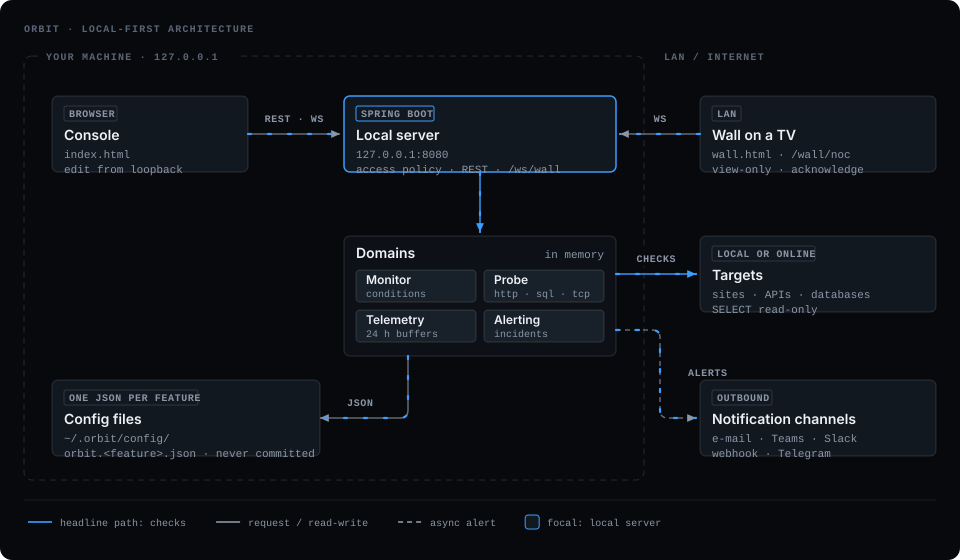
</p>

> **Status:** under active development (MVP). Interfaces, APIs and file formats may still change. Nothing here is production-ready yet.

## Why Orbit

Someone three metres from the TV should know **in one second** whether something is wrong, **where**, and **for how long**, and in five seconds **what to do**. Most dashboards are a static grid of forty identical tiles. Orbit is the opposite:

- **Exceptions first.** What is healthy stays small and quiet; what needs action grows and shows the rule it broke (`QTY = 347 · rule QTY < 200`).
- **The operator writes what to observe; Orbit figures out the rest.** Paste a `SELECT` and the columns and types are detected. Paste a URL and the response is explored. Then pick what to keep and how to show it.
- **Local-first.** Orbit runs entirely on your machine: no account, no login, no database of its own. The only traffic it sends out is the checks and notifications you configure.

## Highlights

- **SQL monitor**: paste a `SELECT` (Oracle, Postgres, SQL Server, MySQL), preview the result with detected column types and turn columns into metrics, charts and alerts. Read-only, validated, with timeout and row limit.
- **HTTP monitor**: status, response time, JSONPath on the body, certificate expiry, metric extraction, cloud-metadata guard.
- **Gatus-style conditions**: `[STATUS] == 200`, `[COL].PENDING_QTY < 200`, with warning/down levels and hysteresis.
- **Wall (TV mode)**: hero panel with the worst incident, near threshold, monitor matrix, timeline and acknowledgement.
- **Incidents and alerts**: acknowledgement, escalation and channels (e-mail, Teams, Slack, Telegram, webhook).
- **20 display modes** with a picker that shows your real data in every compatible mode.
- **Personalization**: custom color themes with a contrast guard, animation level, density and a drag-and-drop wall editor.
- **Privacy by design (LGPD & PCI DSS)**: card numbers, CVV, CPF, e-mails and secrets are masked at the probe boundary.
- **Internationalization**: English by default, Brazilian Portuguese built in.

## How it works


1. The **scheduler** runs each monitor at its interval on virtual threads.
2. The **probe** executes the HTTP request, `SELECT` or TCP check with timeout and a per-target circuit breaker.
3. The **redactor** masks sensitive values before anything leaves the probe.
4. **Conditions** are evaluated, and hysteresis keeps a monitor from flapping between states.
5. A **state change** (`OK`, `WARN`, `DOWN`) opens or closes an incident and notifies channels.
6. The new state is **pushed to the wall over WebSocket**, so there is no polling.

## Features

### SQL monitor

The differentiator. Choose a read-only connection, paste a `SELECT` and run a preview. Orbit validates it (only `SELECT`/`WITH`, no DML/DDL, blocked functions such as `DBMS_*` and `pg_sleep`), wraps it with a dialect-specific row limit, runs it with a timeout and shows the result with detected types. It then suggests how to read the result: single value, indicator card, ranking, time series, table or row count.

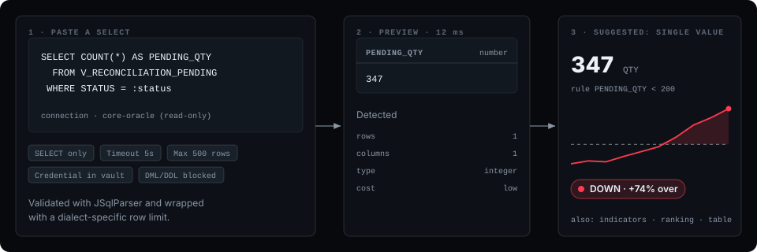

### HTTP monitor

Method, URL, headers, body and authentication (Basic, Bearer, API key, OAuth2 client credentials), with secrets kept encrypted. **Test now** shows status, time, headers and the formatted body. Click any JSON node to turn it into a field. `$.queue.size` becomes its own series with a chart and a rule, without creating another monitor.

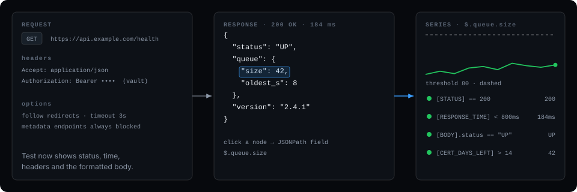

### Conditions

Short Gatus-style expressions evaluated against every result: `[STATUS]`, `[RESPONSE_TIME]`, `[BODY]` (JSONPath), `[ROWS]`, `[COL].<name>`, `[EXEC_TIME]`, `[CERT_DAYS_LEFT]`. Operators are `<`, `<=`, `>`, `>=`, `==`, `!=`, `between`, `in` and time comparisons. Each condition has a level, warning or down, and is validated live against the preview ("this would fail right now"). There is no scripting engine, only small typed evaluators.

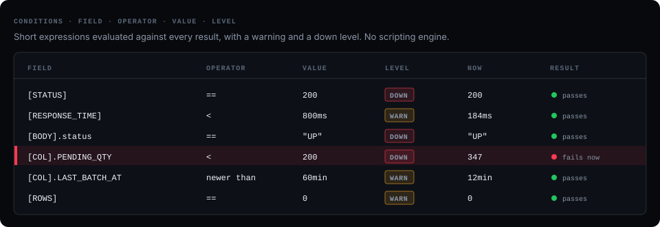

### The wall (TV mode)

Built for 16:9 with zero scroll. When something breaks, the worst incident takes over half the screen with its rule, deviation, a 60-minute chart with the threshold line, the likely impact, the escalation countdown and a single **Acknowledge** button. When everything is green, the wall calms down and shows business indicators. Colour always comes with a text label, and values use tabular numbers so they don't jump.

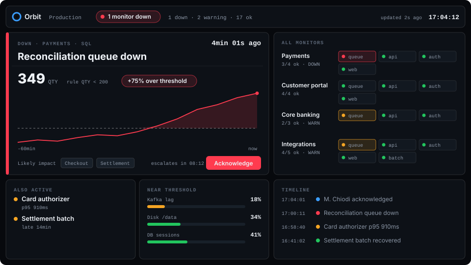

### Incidents and alerts

An incident opens when a monitor goes down and closes by itself on recovery. Acknowledge with your name, comment, link a ticket, and let escalation policies notify the next level only when nobody responds. Suppression removes noise: dependency cascades, maintenance windows, grouping of equal alerts and silences with a reason. A postmortem with time to acknowledge and time to resolve is generated automatically.

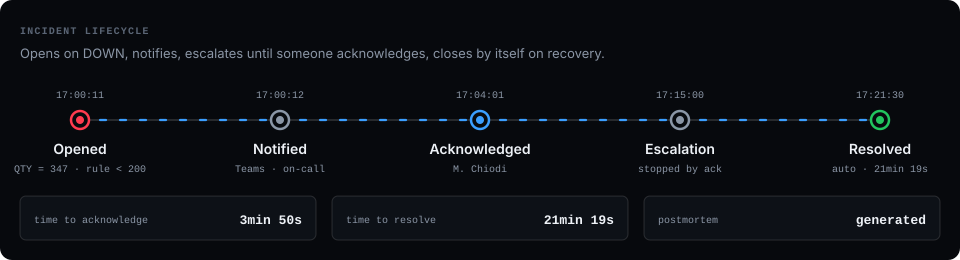

### 20 ways to see the data

Every field can be shown as a big number, gauge, bullet chart, headroom bar, KPI card, line, area, step line, ranking, stacked bar, donut, hour-by-weekday heatmap, calendar heatmap, uptime ribbon, traffic light, status pill, live table, small multiples, histogram or hex grid. The **visualization picker** renders your real data in every compatible mode side by side, so you click the one you like instead of guessing.


### Custom themes

Create your own color theme from the design tokens with a live preview of the wall and console. A **contrast guard** checks every text and status color against WCAG (4.5:1 for text, 3:1 for large labels) and keeps OK, WARN and DOWN distinguishable. Presets include Orbit Dark, Light, High contrast, OLED and color-blind safe palettes. Themes can be exported and imported as JSON.

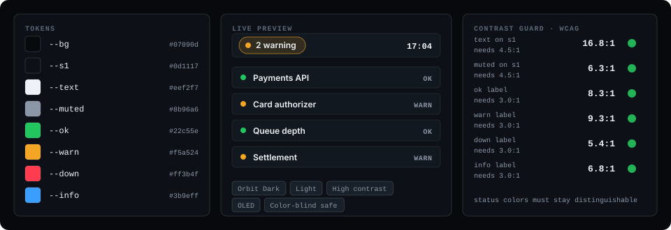

### Animation level

Motion in Orbit communicates state and never decorates. Choose **Off**, **Minimal**, **Standard** or **Expressive**. Nothing uses springs and nothing moves more than 8 px. The operating system's `prefers-reduced-motion` setting always wins and forces Off.


### Drag-and-drop wall editor

Build layouts such as `NOC`, `Executive` or `Payments team` on a 12-column grid: drag, drop and resize blocks, preview in 1080p and 4K, undo and redo, and simulate an incident to see how the wall reacts. Everything works with the keyboard too (Space to grab, arrows to move, Esc to cancel). Each TV opens its own layout by URL (`/wall/noc`).


## Privacy by design

Orbit runs arbitrary queries against production systems, so a result may contain cardholder or personal data. **A full card number never leaves the probe.** It does not reach the API, the WebSocket, logs, alerts, exports, memory buffers or configuration files, and there is no setting to turn this off.

- Card numbers are detected by value (13 to 19 digits that pass the Luhn check) and by field name, then shown as `•••• •••• •••• 1111` at most.
- CVV, track data and PIN are always `[REDACTED]`.
- CPF/CNPJ (with check digits), e-mails, phones and tokens are masked by default and never appear on the wall.
- Only the fields you explicitly select are kept. A Logback converter masks logs, and the frontend renders every probe value through `<SafeValue>` as a second line of defense.

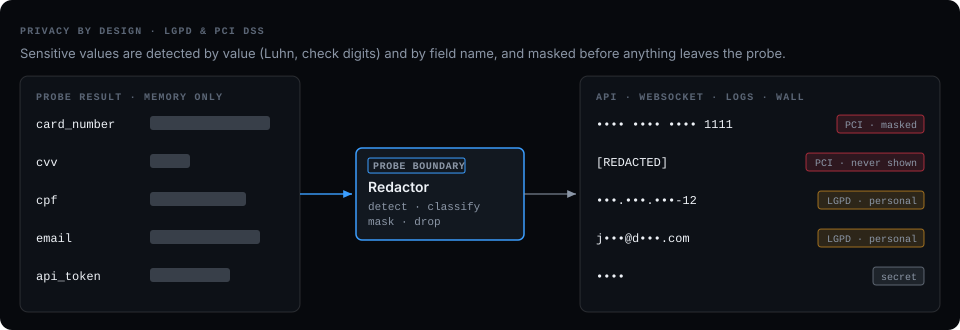

See [docs/04-data-protection.md](docs/04-data-protection.md) for the full LGPD and PCI DSS control map.

## No login, access by network

There are no accounts, passwords or roles. Orbit binds to `127.0.0.1` by default. Edits are accepted only from the machine running it. Other devices on the network, like the laptop of a colleague or the TV, get a view-only console and the wall, and can still acknowledge incidents. The console asks for your display name once, so acknowledgements read `M. Chiodi acknowledged at 17:04`.

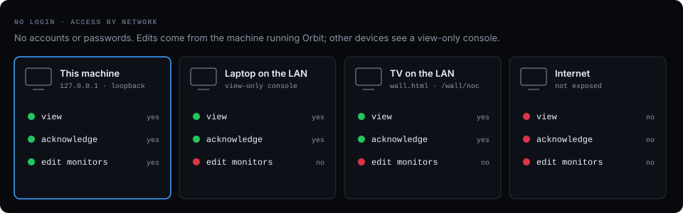

## Configuration files

There is no database. Everything you configure is saved in **one JSON file per feature** under `~/.orbit/config/` (`orbit.requests.json`, `orbit.selects.json`, `orbit.connections.json`, `orbit.layouts.json`, …), created as you go:

- Each file is validated against its own JSON Schema and written atomically, with a `.bak` copy of the previous version.
- Secrets are encrypted with AES-256-GCM using `~/.orbit/master.key`, or referenced as `${env:NAME}`.
- Runtime history lives in memory (24 hours by default) and is lost on restart.

**These files are never committed.** `.gitignore` and a tracked pre-commit hook block them; only `*.example.json` and `*.schema.json` belong in the repository.

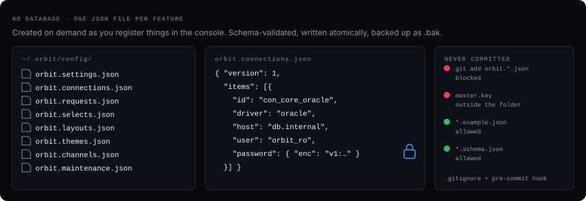

Details in [docs/06-configuration-files.md](docs/06-configuration-files.md).

## Internationalization

The whole repository is written in English. The product speaks **English (default)** and **Brazilian Portuguese**: every user-facing string goes through i18n, and numbers, currency and relative times use `Intl` for the active locale. On the wall, add `?lang=pt-BR`.

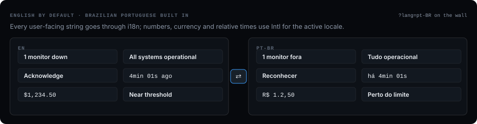

## Repository layout

| Path | Contents |
|---|---|
| [`backend/`](backend/) | Java 21 + Spring Boot 3, Maven multi-module (one module per domain) |
| [`frontend/`](frontend/) | React 19 + Vite + TypeScript + Tailwind CSS v4 + Motion |
| [`docs/01-architecture.md`](docs/01-architecture.md) | Architecture and domains |
| [`docs/02-features.md`](docs/02-features.md) | Features |
| [`docs/03-design.md`](docs/03-design.md) | Design principles and tokens |
| [`docs/04-data-protection.md`](docs/04-data-protection.md) | LGPD and PCI DSS controls |
| [`docs/05-extended-features.md`](docs/05-extended-features.md) | 100 extended features (FE/BE) and pending-test convention |
| [`docs/06-configuration-files.md`](docs/06-configuration-files.md) | Per-feature JSON configuration files (never committed) |
| [`docs/07-customization.md`](docs/07-customization.md) | Everything is configurable: registry, scopes, Customize mode, terminology |
| [`docs/08-logs-and-history.md`](docs/08-logs-and-history.md) | 30-day history in compact compressed logs (no database) |
| [`.claude/context/`](.claude/context/) | Living context: one file per screen and per feature |

## Running locally

Requirements: Java 21 and Node.js 20+.

```bash
# backend (creates ~/.orbit/config on first run)
cd backend && ./mvnw -pl orbit-api -am spring-boot:run

# frontend (another terminal)
cd frontend && npm install && npm run dev
# console: http://localhost:5173    wall: http://localhost:5173/wall.html
```

Tests (TDD is the rule; tests for features not built yet are tagged *pending* and excluded from the default run):

```bash
cd backend && ./mvnw test           # ./mvnw test -Ppending for pending tests
cd frontend && npm test             # npm run test:pending
```

See each folder's README for details.

After cloning, enable the hook that keeps configuration files and secrets out of Git:

```bash
git config core.hooksPath .githooks
```

## Roadmap

| Stage | Scope |
|---|---|
| **MVP** | Access policy and vault, groups, HTTP and SQL monitors with preview and conditions, telemetry, incidents with acknowledgement, e-mail/Teams/webhook channels, wall with a fixed layout |
| **v1.1** | Wall layout editor, value/table/ranking blocks, dependencies and cascade suppression, escalation, Push and Ping |
| **v1.2** | History-based anomaly detection, query catalog, SLA reports, status page, Uptime Kuma import |

The full list of 100 extended features (themes, animation levels, the 20 display modes, kiosk mode and more) is in [docs/05-extended-features.md](docs/05-extended-features.md).

## Contributing

Please read [CONTRIBUTING.md](CONTRIBUTING.md). Work happens on the `developer` branch, and `main` holds the stable base. To report a vulnerability, see [SECURITY.md](SECURITY.md).

## License

[MIT](LICENSE) © 2026 Matheus Chiodi
